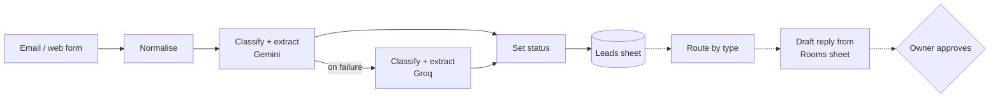

# Rental Lead Automation

An n8n workflow that turns incoming rental enquiries into structured, qualified leads. It classifies each message, extracts the details a landlord needs, and saves the lead to Google Sheets, with automatic fallback to a second LLM provider.

> **Status:** in active development. All data in this repository is synthetic.

## The problem

A small landlord receives every kind of message in one inbox: people looking for a room, agencies, existing tenants and spam. Each type needs a different response, and the details that matter (budget, move-in date, length of stay) are buried in free text. Sorting the messages and copying those details by hand is repetitive work that this workflow takes over.

The full analysis is in the [process map](docs/process-map.md).

## How it works

Solid lines are built. Dashed lines are planned.

1. **Normalise.** Each channel names its fields differently. The first step maps every message to the same five fields, so the rest of the workflow is independent of the channel.
2. **Classify and extract.** One LLM call assigns a category (`room_enquiry`, `agency`, `existing_tenant`, `spam`, `other`) and extracts name, phone, room type, move-in date, budget, length of stay and number of people.
3. **Fallback.** If the primary provider fails, the message is sent to a second provider. If both fail, the workflow stops with the error.
4. **Set status.** A code step marks a room enquiry as `needs info` when a required detail is missing.
5. **Save.** The lead is written to Google Sheets, keyed on the message ID.

## Design decisions

| Decision | Reason |
|---|---|
| Channel-independent core | Adding a channel means adding an entrance, not rebuilding the workflow |
| Schema-enforced output | The primary model must answer with fixed fields and a fixed list of categories |
| Provider fallback | A provider outage does not stop lead intake |
| Idempotent writes | Re-processing a message updates its row and never duplicates it |
| Fixed rules in code | "Is a detail missing?" is decided by code, not by a model |
| Replies grounded in data | Prices and availability come from a Rooms sheet, never from the model's memory |
| Human approval | Every drafted reply waits for the owner before it is sent |

## Status

| Stage | State |
|---|---|
| Process map | Done |
| Intake normalisation (email, web form) | Done |
| Classification and extraction with provider fallback | Done |
| Lead storage in Google Sheets | Done |
| Routing by message type | Planned |
| Owner alerts | Planned |
| Reply drafts grounded in the Rooms sheet | Planned |
| Approval step | Planned |
| Error workflow and logging | Planned |
| WhatsApp intake | Planned |
| Workflow export, setup guide and demo | Planned |

Results (time saved, extraction accuracy, cost per run) will be published here once the workflow is complete and measured.

## Stack

- [n8n](https://n8n.io), self-hosted with Docker
- Google Gemini API, with Groq as the fallback provider
- Google Sheets

The project runs entirely on free tiers.

## Adapting it to another business

Three things change per business: the message categories, the details to extract, and the facts sheet. The [process map](docs/process-map.md#5-the-same-map-for-other-businesses) shows the same design applied to a clinic and a tuition centre.

## Repository

| Path | Contents |
|---|---|
| [docs/process-map.md](docs/process-map.md) | The business process and where automation fits |
| [workflows/](workflows/) | Exported n8n workflows |
| `.env.example` | The API keys the project needs, without values |
