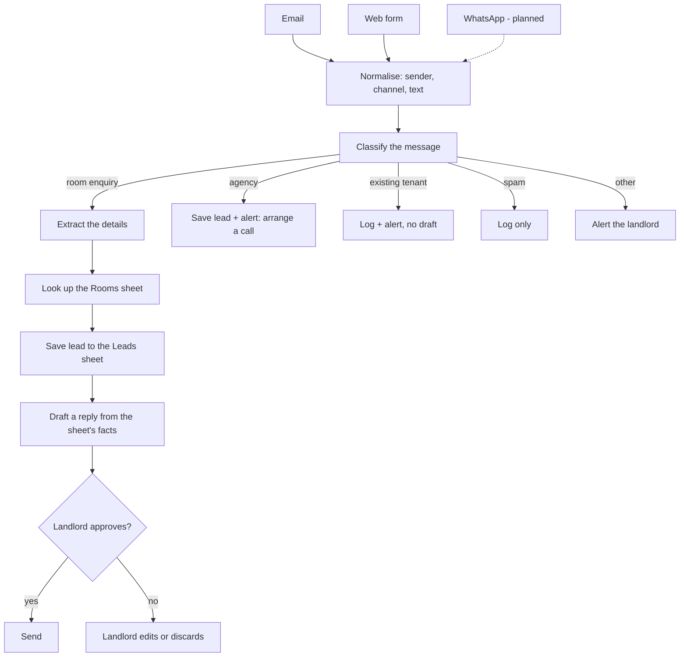

# Process map

How a small room-rental business handles incoming messages, and which parts the workflow takes over.

The example is a landlord renting rooms near a university. The same map fits any small business that gets enquiries, which is shown in the last section.

## 1. Who writes in, and what happens today

| Sender | What they want | What the landlord does |
|---|---|---|
| Student, worker or tourist | One specific room: a price range, a location, a move-in date | Replies, then arranges a viewing |
| Agency | A list of all available rooms, or to manage the property | Arranges a call or a meeting |
| Existing tenant | Payment, repair or renewal | Handles it personally |
| Spam | Nothing useful | Ignores it |
| Anything else | Unclear | Reads it and decides |

Channels: email and a web form. WhatsApp is planned as a third entrance.

## 2. What the landlord needs from an enquiry

| Detail | Why |
|---|---|
| Name and phone | To follow up |
| Room type | To check what fits |
| Move-in date | To check availability |
| Budget | To check the price fits |
| Length of stay | To check it meets the minimum contract |
| Number of people | To check the room is big enough |
| Company name (agencies only) | To know who the partner is |

If a detail is missing, the landlord asks for it. The workflow does the same: it saves the lead as "needs info" and drafts a reply asking only for what is missing.

## 3. The flow

## 4. Machine or human

| Step | Who | Why |
|---|---|---|
| Sort the message into a type | Machine | Repetitive, and a wrong guess is cheap to correct |
| Pull out the details | Machine | Copying, not deciding |
| Answer price, deposit, availability, contract length | Machine drafts, **only from the Rooms sheet** | The model does not know this landlord's prices. Without the sheet it would invent a believable number |
| Confirm a viewing, call or meeting | Human | It commits the landlord's time |
| Send any reply | Human approves | Every draft waits for approval. How often the landlord edits a draft is the accuracy measure |

## 5. The same map for other businesses

Only three things change per business: the message types, the details to extract, and the facts sheet. The flow stays the same.

| | Room rental | Clinic | Tuition centre |
|---|---|---|---|
| New customer | Room enquiry | Appointment request | Class enquiry |
| Partner | Agency | Insurance panel or supplier | School or corporate client |
| Existing customer | Tenant | Patient | Enrolled student or parent |
| Details to extract | Move-in date, budget, length of stay | Preferred date, service, urgency | Subject, level, schedule |
| Facts sheet | Rooms: price, deposit, availability | Services: price, doctor, slots | Classes: fee, timetable, seats |
| Human must approve | Viewings and meetings | Booking a slot | Trial class and enrolment |
